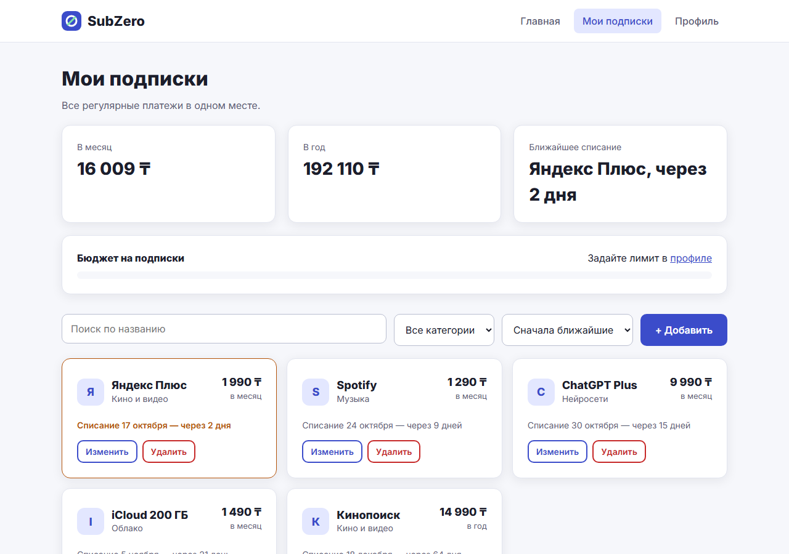
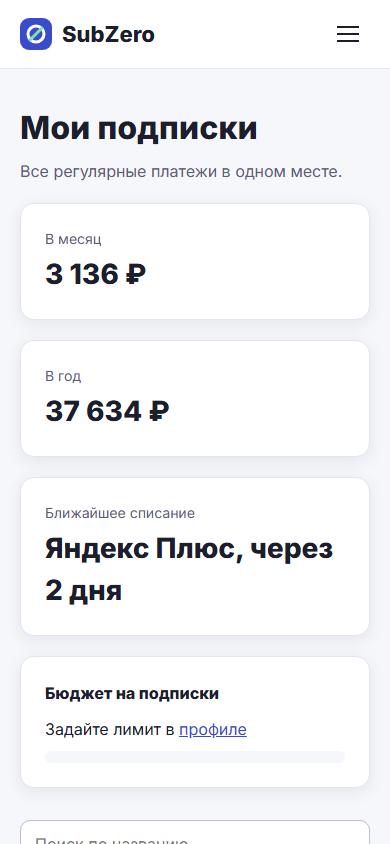
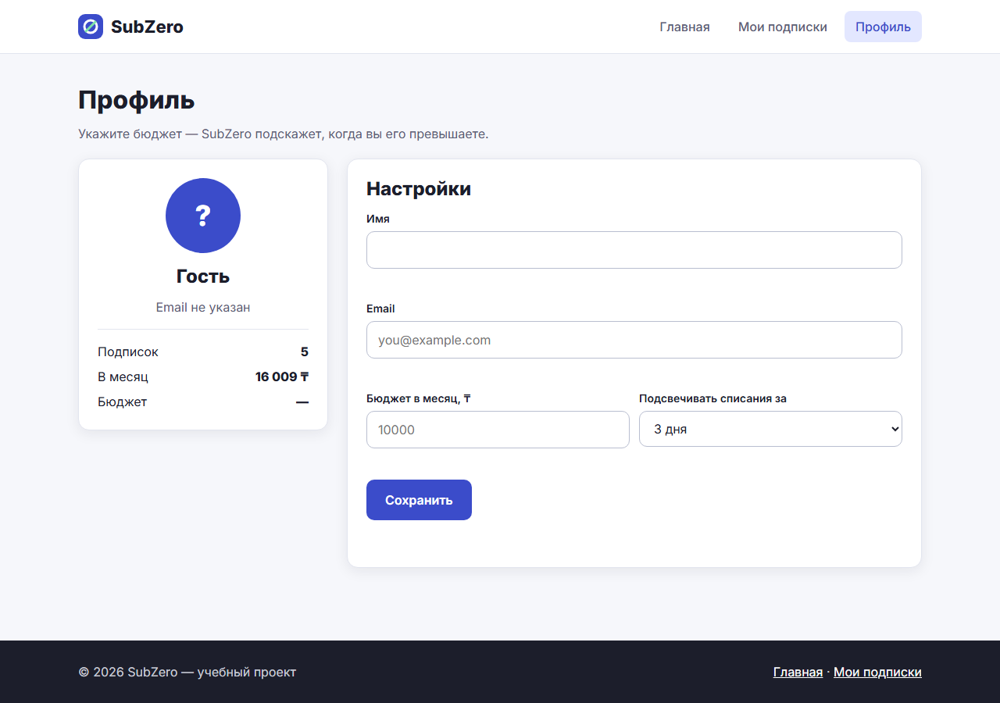
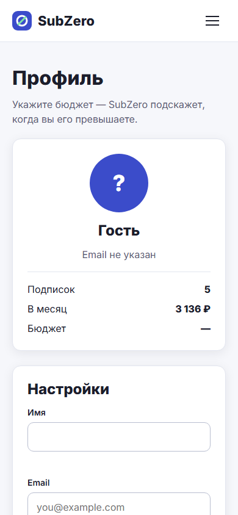

# SubZero — трекер подписок

**Проблема:** кино, музыка, облако, нейросети — подписки по 199–399 ₽ незаметно складываются в тысячи рублей в месяц.
Пробные периоды превращаются в платные, а про ненужные сервисы забывают.

**Аудитория:** студенты и молодые специалисты 18–30 лет с несколькими цифровыми подписками и ограниченным бюджетом.

**Решение:** SubZero собирает все подписки в одном месте, считает реальные траты в месяц и в год,
подсвечивает скорые списания и предупреждает о превышении бюджета.

🔗 Сайт: https://nikitaarepyev.github.io/Subzero9012748/

## Скриншоты

| Десктоп | Мобильный |
|---|---|
|  |  |
|  |  |
|  |  |

## Страницы

- **Главная** (`index.html`) — проблема, как работает сервис, FAQ, призыв к действию.
- **Мои подписки** (`subscriptions.html`) — ключевой сценарий: список подписок, суммы, бюджет.
- **Профиль** (`profile.html`) — имя, email, бюджет и настройки напоминаний.

## Реализованные функции

1. **Мобильное меню** — бургер-кнопка с анимацией в крестик, `aria-expanded` для скринридеров.
2. **Добавление и редактирование подписок** в модальном окне (нативный `<dialog>`: закрытие по Esc, кнопке и клику по фону).
3. **Валидация форм** — название, цена, дата в модальном окне; имя, email и бюджет в профиле. Ошибки выводятся под полями.
4. **Поиск, фильтр по категории и сортировка** списка (по дате, цене, названию).
5. **Удаление подписок**.
6. **Подсчёт расходов** — в месяц и в год (годовые тарифы пересчитываются в месячные), ближайшее списание.
7. **Полоса бюджета** — зелёная / жёлтая (от 80%) / красная (превышение).
8. **Подсветка скорых списаний** — за 1, 3 или 7 дней (настраивается в профиле).
9. **Автоперенос даты** — если дата списания прошла, она переносится на следующий месяц/год.
10. **Хранение данных в localStorage** — подписки и профиль сохраняются между визитами.
11. **FAQ-аккордеон** на главной (нативный `<details>`, без JS).

## Технологии

HTML5, CSS3 (переменные, Flexbox, Grid, media queries), JavaScript без фреймворков.

## Структура

```
index.html            — главная
subscriptions.html    — мои подписки
profile.html          — профиль
css/style.css         — общие стили (CSS-переменные в :root)
js/main.js            — общий код: меню, localStorage, даты, расчёт цен
js/subscriptions.js   — логика страницы подписок
js/profile.js         — логика профиля
img/                  — логотип, иллюстрация, скриншоты
```

## Запуск

Открыть `index.html` в браузере — сборка и сервер не нужны.
